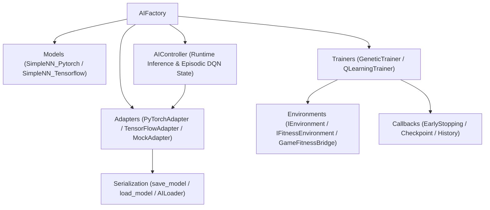

# PyForgeAI

[](https://deepwiki.com/Drakonosinc/PyForgeAI)
[](https://pypi.org/project/pyforgeai-engine/)
[](https://www.python.org/)
[](https://pytorch.org/)
[](LICENSE)

**PyForgeAI** is a modular, multi-backend game AI training and inference library built for **Pygame** and real-time Python simulations. Designed around the `AIFactory`, `ITrainer`, and `IAIModel` patterns, it unifies **Neuroevolution (Genetic Algorithms)** and **Deep Q-Learning (Double-DQN)** into a clean, zero-boilerplate package with automatic HUD activation tracking and backward-compatible checkpoint serialization.

---

## Features

- **Unified Training Algorithms (`Trainers`)**:
  - **`GeneticTrainer` (Neuroevolution)**: Elitism, multi-trial fitness averaging, uniform tensor crossover, **adaptive mutation scaling** on fitness stagnation, and periodic **random diversity injection**.
  - **`QLearningTrainer` & `DQNAgent` (Deep Reinforcement Learning)**: Experience `ReplayMemory`, **Double-DQN** action evaluation, Huber/MSE loss, gradient clipping, and epsilon-greedy exploration decay.
- **Multi-Backend Neural Networks & Adapters (`Models` & `Adapters`)**:
  - Dynamic multi-layer perceptrons (`SimpleNN_Pytorch` & `SimpleNN_Tensorflow`) with configurable `hidden_sizes` and activation functions (`relu`, `tanh`, `leaky_relu`, `elu`).
  - Built-in normalized layer-1 activation capture (`model.activations` in `[0, 1]`) for real-time HUD neural network rendering, with a headless fast-mode toggle (`record_activations=False`).
  - `PyTorchAdapter`, `TensorFlowAdapter`, and `MockAdapter` implementing the unified `IAIModel` contract (`predict`, `predict_action`, `predict_probabilities`, `get_weights`, `set_weights`).
- **Flexible Environment Integration (`Environments`)**:
  - Works seamlessly with step-by-step Gym-like environments (`IEnvironment`), pure fitness callables (`fn(model) -> float`), or legacy Pygame loops (`game.run_with_model()` via `GameFitnessBridge`).
- **Smart Checkpoint Serialization (`Serialization`)**:
  - Automatic architecture metadata persistence and legacy layer remapping (`fc1`/`fc2` $\rightarrow$ `hidden_layers.*`) via `save_model`, `load_model`, and configuration-driven `AILoader`.
- **Training Lifecycle Callbacks**:
  - Built-in `EarlyStoppingCallback`, `CheckpointCallback`, and `HistoryCallback`.

---

## Architecture



---

## Installation

### From PyPI
```bash
pip install pyforgeai-engine
```

### Local Editable Install (for development or local game projects)
```bash
pip install -e .
```

Optional TensorFlow backend support:
```bash
pip install -e ".[tensorflow]"
```

---

## Quickstart

### 1. Neuroevolution (`GeneticTrainer`)

```python
from pyforgeai import AIFactory, EarlyStoppingCallback, TargetSeekEnvironment, save_model

env = TargetSeekEnvironment(max_steps=80, seed=42)

factory = AIFactory({
    "type_model": "Pytorch",
    "input_size": env.state_size,
    "output_size": env.action_size,
    "hidden_sizes": [16, 16],
})

trainer = factory.create_GeneticTrainer(
    generations=50,
    population_size=20,
    elitism=2,
    num_trials=3,
    adaptive_mutation=True,
    diversity_interval=10,
    callbacks=[EarlyStoppingCallback(patience=10)],
)

result = trainer.train_with_result(env)
save_model(result.best_model, "AI/best_genetic_model.pth")
```

### 2. Deep Q-Learning (`QLearningTrainer` / `DQNAgent`)

```python
from pyforgeai import AIFactory, TargetSeekEnvironment

env = TargetSeekEnvironment(max_steps=80)
factory = AIFactory({
    "input_size": env.state_size,
    "output_size": env.action_size,
    "hidden_sizes": [32, 32],
})

dqn_trainer = factory.create_QLearningTrainer(
    episodes=200,
    lr=1e-3,
    gamma=0.99,
    epsilon_start=1.0,
    epsilon_end=0.02,
    epsilon_decay=0.995,
    double_dqn=True,
    save_path="AI/best_dqn_model.pth",
)

result = dqn_trainer.train_environment_with_result(env)
```

### 3. Runtime Inference in Pygame (`AIController`)

```python
from pyforgeai import AIController, load_model

model = load_model("AI/best_genetic_model.pth", "Pytorch")

controller = AIController(
    state_provider=lambda: game.get_observation_array(),
    action_dispatcher=lambda action_idx: game.apply_ai_action(action_idx),
)
controller.set_runtime_model(model)

# Inside your Pygame loop:
chosen_action = controller.select_action(deterministic=True)
```

---

## Running the Showcase Demo & Unit Tests

Run the standalone training and inference showcase:
```bash
python demo_ai_training.py
```

Run the automated test suite:
```bash
python -m unittest discover -s tests -v
```

Build `.whl` and `.tar.gz` distributions for PyPI:
```bash
pip install build twine
python -m build
twine upload dist/*
```

---

## License

This project is licensed under the [MIT License](LICENSE).

## Author

Developed by [Drakonosinc](https://github.com/Drakonosinc)
